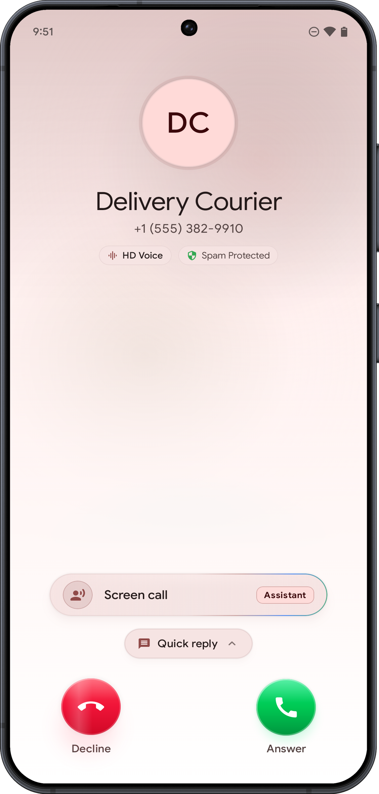

<p align="center">
  
</p>

<h1 align="center">Resonix</h1>

<p align="center">
  <strong>Advanced Android Telephony Platform and Hardware Audio Screening Engine</strong>
</p>

<p align="center">
  <a href="https://android.com"></a>
  <a href="https://developer.android.com"></a>
  <a href="https://kotlinlang.org"></a>
  <a href="https://developer.android.com/jetpack/compose"></a>
  <a href="LICENSE"></a>
  <a href="https://github.com/hunterdp11/resonix-releases/releases"></a>
</p>

---

## Overview

Resonix is an open-source Android dialer and telephony audio routing platform built with Kotlin and Jetpack Compose. It operates in two tiers: a standard Android Telecom dialer for unrooted devices, and a root-privileged hardware ALSA audio injection engine for Magisk, KernelSU, and APatch environments.

---

## Visual Interface

| 1. Incoming Call | 2. In-Call Telephony Suite | 3. Live AI Screening Studio |
| :---: | :---: | :---: |
|  |  |  |
| **Incoming Call Screen**<br>Caller ID verification, spam protection status, and one-tap screening trigger. | **In-Call Controls Suite**<br>Call timer, hold, mute, speakerphone, DTMF keypad, call recording, add call, and speech jammer. | **Live AI Screening Studio**<br>Real-time speech-to-text transcript feed, contextual quick replies, and direct line take-over. |

| 4. Contact Details & Rules | 5. Smart T9 Keypad & Dialer | 6. Telephony Settings & Theme |
| :---: | :---: | :---: |
|  |  |  |
| **Contact Info & Rules**<br>Contact management, per-caller automated screening rules, VIP exemptions, and voice personas. | **Smart T9 Keypad & Dialer**<br>T9 contact search suggestions, call logs, speed dial favorites, and bottom navigation. | **Settings & Theme Engine**<br>Default dialer configuration, spam filters, call recording settings, and light/dark theme toggle. |

---

## Powerful Features

### 1. Root-Privileged Hardware Audio Engine (Magisk / KernelSU / APatch)

When superuser access is granted, Resonix installs an integrated system module that mounts the application into `/system/priv-app/Resonix/` with system-level privileged permissions:

* **Direct Baseband Uplink Injection:**
  * Uses privileged `MODIFY_AUDIO_ROUTING` and `CAPTURE_AUDIO_OUTPUT` system permissions.
  * Streams 16-bit 16kHz linear PCM digital audio directly into the cellular modem uplink ALSA mixer.
* **System Audio and Media Injection into Active Calls:**
  * Streams system audio, media files, and soundboards directly into the active voice call transmission line without loudspeaker bleed.
* **Zero Room Noise / Silent Screening:**
  * Synthesized voice and audio playback do not play through the physical loudspeaker.
  * Audio is injected directly into the voice line, keeping screening sessions silent to nearby listeners.
* **Hardware Noise Suppression and Echo Cancellation:**
  * Fluence dual-mic tuning and hardware acoustic echo cancellation (AEC) and noise suppression (NS).
  * Prevents downlink-to-uplink loopback, ensuring crystal-clear, noise-free calls without background hiss or static.
* **Lossless Two-Way Call Recording:**
  * Direct digital audio capture from cellular uplink and downlink streams without microphone speaker bleed or distortion.
* **Dual-Engine Speech Jammer & Echo Chamber:**
  * **Delayed Auditory Feedback (DAF):** Configurable millisecond speech collision (100ms - 350ms) to disrupt telemarketers and robocallers.
  * **Infinite Echo Chamber:** Multi-tap recursive acoustic reflections with adjustable decay and warm low-pass damping.
  * **Two-Way Echo:** Optional microphone loopback for acoustic reflection testing.
* **Interactive AI Call Screening and Relay:**
  * Real-time on-device speech-to-text transcript feed with conversational message bubbles.
  * Instant contextual quick replies for immediate responses with a single tap.
  * Custom text relay: Type any message to speak it directly to the caller via synthetic voice.
  * Multiple built-in neural voice personas (Sarah, Emma, Lily).
* **Silent One-Tap OTA Updates:**
  * Background installation of newer releases directly from GitHub without system package installer prompts.

---

### 2. Standard Telephony Suite (Non-Root / All Android 8.0+ Devices)

Standard Mode requires zero modifications or root access and functions as your primary system Phone app:

* **Default Phone Dialer:** Complete Android Telecom `InCallService` integration managing all incoming and outgoing cellular calls.
* **Multi-Party Call Management:**
  * Add call capability.
  * Carrier-verified conference merging.
  * Call swapping between active and held lines.
* **Call Log Management:** Filterable call history by All and Missed calls, multi-select deletion, and speed dial favorites with hold-to-delete.
* **Contact Directory:** Fast T9 contact search and alphabetical index scroller.
* **Dynamic Call Capsule:** System-wide floating overlay pill for call management and status display while using other applications.
* **Local Spam Protection:** On-device database for blocking unwanted numbers and filtering incoming call sessions.
* **Integrated GitHub OTA Updates:** In-app release checker with direct download and installation prompts.

---

## Feature Comparison Matrix

| Capability | Standard Mode (Non-Root) | Root-Enhanced Mode |
| :--- | :--- | :--- |
| **Default Phone Dialer** | Supported | Supported |
| **Conference Calls (Add, Merge, Swap)** | Supported | Supported |
| **Call Logs & Multi-Select Deletion** | Supported | Supported |
| **Contacts & T9 Keypad Search** | Supported | Supported |
| **Dynamic Capsule Floating Overlay** | Supported | Supported |
| **Local Number Blocking** | Supported | Supported |
| **Audio Path** | Standard Telephony Audio | Direct PCM Stream into Modem Uplink Mixer |
| **Room Audio Leakage** | Loudspeaker output | Completely Silent (Loudspeaker OFF) |
| **Direct System Audio Injection** | Not Available | Supported |
| **Hardware Echo Cancellation & Dual-Mic NS** | System Default | Kernel & ALSA Tuned Fluence Dual-Mic |
| **Two-Way Lossless Call Recording** | Standard AudioRecord | Direct Uplink/Downlink Digital Capture |
| **Speech Jammer & Echo Chamber** | Not Available | Supported (DAF + Infinite Echo) |
| **AI Call Screening & Relay** | Not Available | Supported |
| **OTA Updates** | System Package Installer | Silent 1-Tap Background Install |

---

## Architecture and Technical Specifications

* **Target SDK:** Android 17 (API 37)
* **Minimum SDK:** Android 8.0 (API 26)
* **Language:** Kotlin with Coroutines and StateFlow for reactive state management.
* **UI Toolkit:** Jetpack Compose with Material 3.
* **Telephony Services:**
  * Android Telecom `InCallService` for call session lifecycle.
  * Android `CallScreeningService` for spam filtering and verification.
* **Audio Engineering:**
  * Direct 16-bit 16kHz linear PCM digital audio injection.
  * ALSA hardware mixer tuning for Qualcomm, MediaTek, and Tensor modems.
* **Root Integration:**
  * Magisk / KernelSU / APatch module generator (`RootPrivilegeManager`).
  * Privileged permission whitelist configuration (`privapp-permissions-com.callscreener.app.xml`).

---

## Installation

### Method 1: Download Pre-built Release
Download the signed release APK from the official [GitHub Releases](https://github.com/hunterdp11/resonix-releases/releases/latest) page:
* File: `Resonix-v1.0.0-release.apk`

### Method 2: Build from Source
```bash
# Clone the repository
git clone https://github.com/hunterdp11/resonix-releases.git
cd resonix-releases

# Build the release APK
./gradlew assembleRelease
```
The resulting APK will be located at:
`app/build/outputs/apk/release/app-release.apk`

---

## Activating Root Mode (Optional)

If your device is rooted with Magisk, KernelSU, or APatch:

1. Install and open **Resonix**, then set it as your default Phone app.
2. On the main dashboard, locate the **Root Priv-App Mode** card.
3. Tap **Activate Magisk / KernelSU Priv-App Module** and grant Superuser permissions when prompted.
4. **Reboot your device.**
5. After rebooting, Resonix will detect the active system module and unlock direct hardware audio injection, call recording, and screening capabilities.

To return to Standard Mode at any time, tap **Uninstall Module** in Settings and reboot.

---

## License

Resonix is open-source software licensed under the **Apache License 2.0**. See the [LICENSE](LICENSE) file for complete license terms.

---

## Author

* **DpXarma** ([@hunterdp11](https://github.com/hunterdp11))
