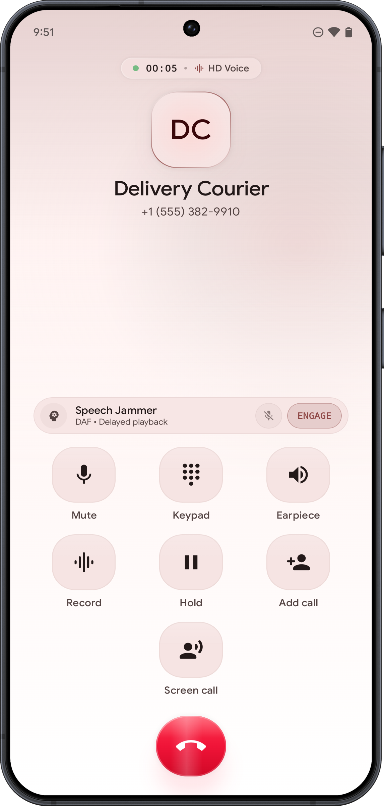
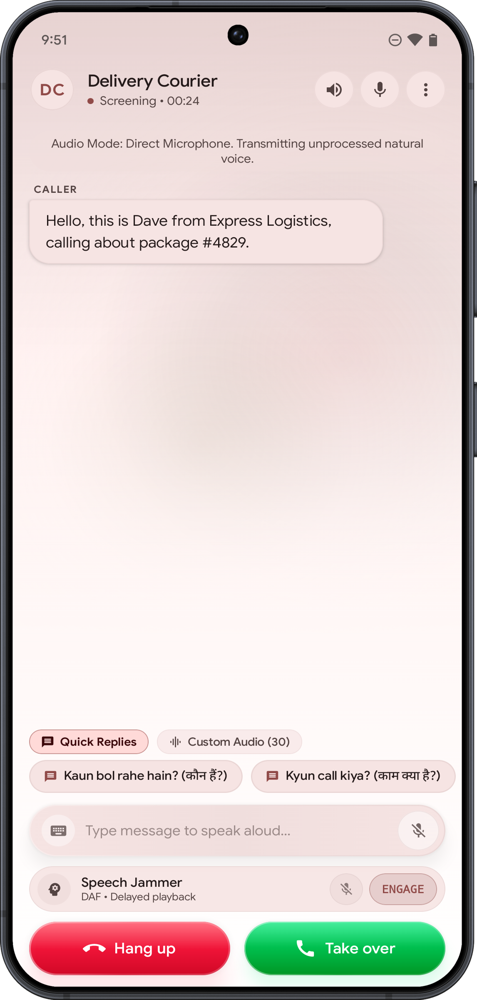
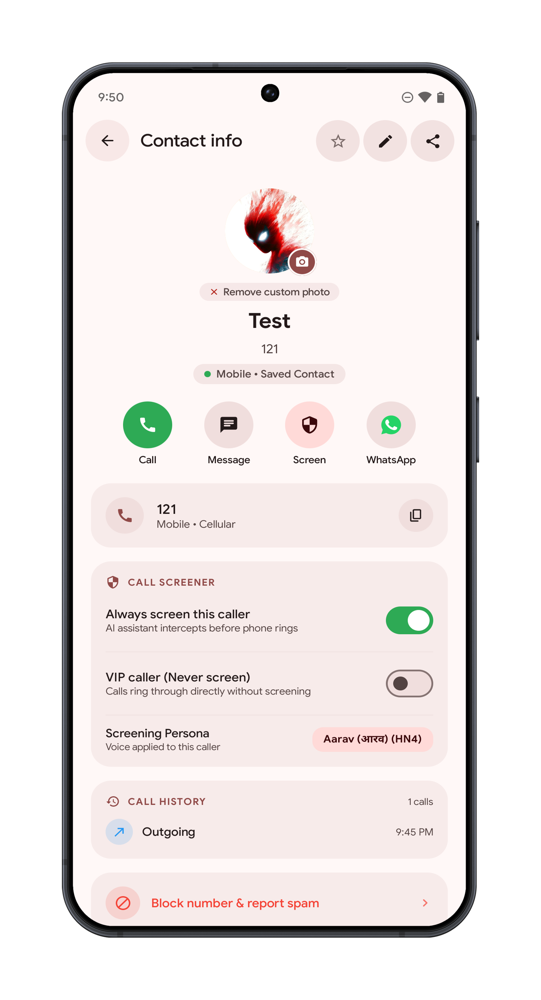
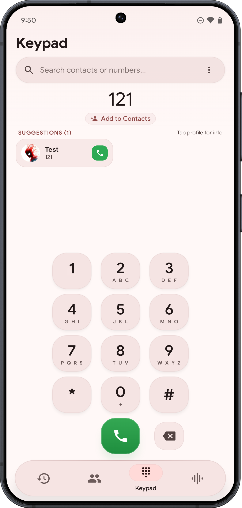
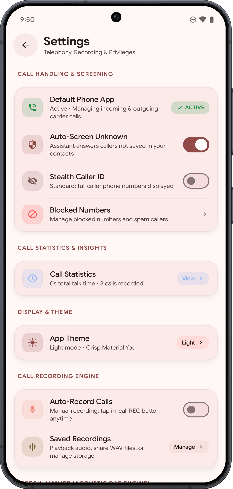

<p align="center">
  
</p>

<h1 align="center">Resonix</h1>

<p align="center">
  <strong>Next-Generation Android Dialer and Smart Call Screening System with Material You Expressive Design</strong>
</p>

<p align="center">
  <a href="https://android.com"></a>
  <a href="https://developer.android.com"></a>
  <a href="https://kotlinlang.org"></a>
  <a href="https://developer.android.com/jetpack/compose"></a>
  <a href="LICENSE"></a>
  <a href="https://github.com/hunterdp11/resonix-releases/releases"></a>
</p>

---

## Overview

Resonix is an open-source Android dialer and call screening platform built with Kotlin and Jetpack Compose. Inspired by Google Pixel Call Screen, Resonix provides a dual-engine architecture: a full-featured, standalone Material You dialer for non-rooted devices, and an optional root-privileged hardware audio injection engine for rooted devices.

---

## Interface & Screenshots

Resonix features an expressive Material You interface with fluid animations, dynamic Monet color extraction, and dedicated call handling modes.

| 1. Incoming Call | 2. In-Call Telephony Suite | 3. Live AI Screening Studio |
| :---: | :---: | :---: |
|  |  |  |
| **Incoming Call Screen**<br>Ambient liquid backdrop, caller ID verification, spam protection badge, and one-tap AI screening invocation. | **In-Call Controls Suite**<br>Active call timer, direct audio path indicators, hold, mute, speaker, keypad, record, add call, and speech jammer. | **Live AI Screening Studio**<br>Real-time speech-to-text live transcripts, instant contextual quick replies, natural voice relay, and direct take-over. |

| 4. Contact Details & Rules | 5. Smart T9 Keypad & Dialer | 6. Telephony Settings & Theme |
| :---: | :---: | :---: |
|  |  |  |
| **Contact Info & Rules**<br>Profile management, direct actions, per-caller automated screening rules, VIP exemptions, and custom voice personas. | **Smart T9 Keypad & Dialer**<br>Rapid T9 contact search suggestions, tactile dialpad keys with haptic feedback, and fluid bottom navigation. | **Settings & Theme Engine**<br>Default Phone app handler, spam filters, statistics, call recording engine, and dynamic light/dark theme switch. |

---

## Operation Modes and Capabilities

Resonix operates in two distinct tiers based on available device privileges.

### 1. Standard Mode (Non-Root / Any Android 8.0+ Device)

Standard Mode requires zero modifications or root access and functions as your primary system Phone app.

* **Default Phone Dialer:** Complete Android Telecom integration managing all incoming and outgoing cellular calls.
* **Material You Dynamic Theming:** Automatically derives light and dark color schemes from the active system wallpaper using Android Monet palette extraction.
* **Ambient Liquid Backdrop:** Fluid procedural background color movement during incoming calls and active sessions.
* **Alphabetical Contacts Quick-Scroller:** High-performance index scrubber with smooth scroll jumping and contact search.
* **Call Log Management:** Filterable call history by All and Missed calls, contact linking, and speed dial favorites.
* **In-Call Telephony Suite:**
  * Hold and resume call functionality.
  * Microphone mute and speakerphone routing.
  * Interactive DTMF tone keypad with standard frequencies.
  * Add call capability with conference merge and active call swapping.
* **Dynamic Call Capsule:** System-wide floating overlay pill for call management and status display while using other applications.
* **Spam and Security Protection:** Local database for blocking unwanted numbers and filtering incoming call sessions.
* **Integrated GitHub OTA Updates:** In-app update checker that downloads and prompts to install new releases directly from GitHub.

---

### 2. Root-Enhanced Mode (Magisk / KernelSU / APatch)

When superuser access is granted, Resonix can install an integrated system module that mounts the application into `/system/priv-app/Resonix/` with system-level privileged permissions.

* **Direct Cellular Audio Injection:**
  * Uses the privileged `MODIFY_AUDIO_ROUTING` and `CAPTURE_AUDIO_OUTPUT` system permissions.
  * Feeds 16-bit 16kHz linear PCM digital audio streams directly into the active cellular modem uplink mixer.
* **Zero Room Noise (Loudspeaker Stays Off):**
  * Synthesized voice and audio playback do not play through the device loudspeaker.
  * Audio is injected directly into the voice line, making AI call screening completely silent to people around you.
* **Interactive AI Call Screening:**
  * Real-time conversational assistant UI displayed during active screening sessions.
  * Live speech-to-text transcript feed with conversational message bubbles.
  * Instant quick replies for immediate responses with a single tap.
  * Custom text relay: Type any message to synthesize natural speech directly to the caller.
* **Multi-Persona Voice Studio:**
  * Multiple built-in neural female voice personas (Sarah, Emma, Lily) suited for professional, formal, or casual screening.
* **Speech Jammer Tool:**
  * Direct-to-line delayed auditory feedback engine designed to deter automated telemarketers and spam callers.
* **Silent One-Tap OTA Updates:**
  * Performs silent background installation of newer releases without requiring system package installer dialogs.

---

## Feature Comparison Matrix

| Capability | Standard Mode (Non-Root) | Root-Enhanced Mode |
| :--- | :--- | :--- |
| **Default Phone Dialer** | Supported | Supported |
| **Material You Dynamic Theming** | Supported | Supported |
| **Contacts & Quick-Scroller** | Supported | Supported |
| **Call Logs & Speed Dial** | Supported | Supported |
| **In-Call Controls (Hold, Mute, Speaker, DTMF)** | Supported | Supported |
| **Conference Calls (Add, Merge, Swap)** | Supported | Supported |
| **Dynamic Capsule Overlay** | Supported | Supported |
| **Local Number Blocking** | Supported | Supported |
| **Audio Path** | Standard Telephony Audio | Direct PCM Byte Stream into Cellular Uplink Mixer |
| **Room Audio Leakage** | Speakerphone output | Completely Silent (Loudspeaker OFF) |
| **AI Call Screening & Relay** | Not Available | Supported |
| **Speech Jammer Engine** | Not Available | Supported |
| **OTA Updates** | System Package Installer | Silent 1-Tap Background Install |

---

## Architecture and Technology Stack

* **Language:** Kotlin 100% with Coroutines and StateFlow for reactive state management.
* **UI Toolkit:** Jetpack Compose with Material 3, custom Canvas animations, and Monet color extraction.
* **Telephony Services:**
  * Android Telecom `InCallService` for call session lifecycle.
  * Android `CallScreeningService` for spam filtering and verification.
* **Audio Engineering:**
  * `AudioTrack` configured with `STREAM_VOICE_CALL` / `USAGE_VOICE_COMMUNICATION`.
  * Direct 16-bit 16kHz PCM digital uplink injection.
* **Root Integration:**
  * Automated Magisk / KernelSU magic-mount module generator (`RootPrivilegeManager`).
  * Privileged permission whitelist configuration (`privapp-permissions-com.callscreener.app.xml`).

---

## Installation

### Method 1: Download Pre-built Release
Download the signed release APK from the official [GitHub Releases](https://github.com/hunterdp11/resonix-releases/releases/latest) page.

### Method 2: Build from Source
```bash
# Clone the repository
git clone https://github.com/hunterdp11/resonix-releases.git
cd resonix-releases

# Build the release APK
./gradlew assembleRelease
```
The resulting APK will be located at:
`app/build/outputs/apk/release/app-release.apk`

---

## Activating Root Mode (Optional)

If your device is rooted with Magisk, KernelSU, or APatch:

1. Install and open **Resonix**, then set it as your default Phone app.
2. On the main dashboard, locate the **Root Priv-App Mode** card.
3. Tap **Activate Magisk / KernelSU Priv-App Module** and grant Superuser permissions when prompted.
4. **Reboot your device.**
5. After rebooting, Resonix will detect the active system module and unlock direct audio injection and AI screening capabilities.

To return to Standard Mode at any time, tap **Uninstall Module** in Settings and reboot.

---

## Contributing

Contributions, bug reports, and suggestions are welcome.
1. Fork the repository.
2. Create your feature branch (`git checkout -b feature/NewFeature`).
3. Commit your changes (`git commit -m 'feat: add NewFeature'`).
4. Push to your branch (`git push origin feature/NewFeature`).
5. Open a Pull Request.

---

## License

Resonix is open-source software licensed under the **Apache License 2.0**. See the [LICENSE](LICENSE) file for complete license terms.

---

## Author

* **DpXarma** ([@hunterdp11](https://github.com/hunterdp11))
