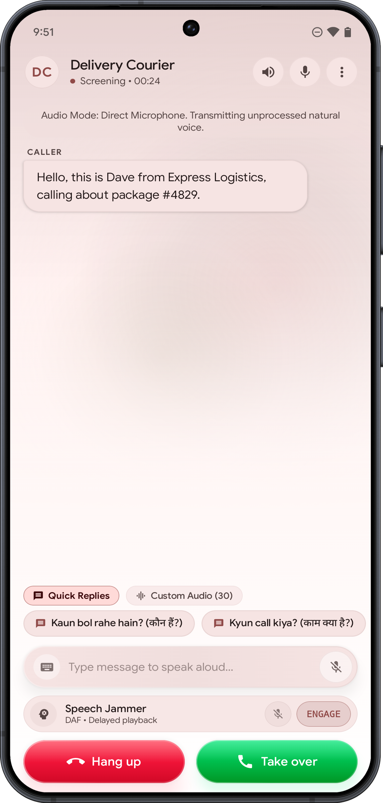
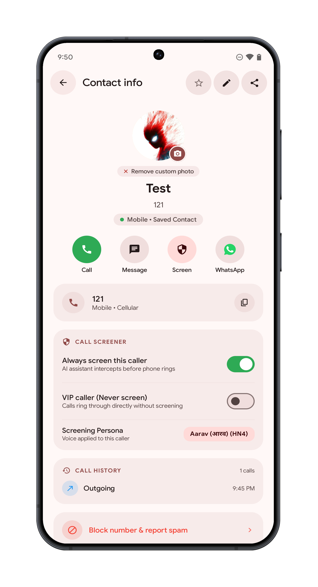

# Resonix v1.0.0 — Official Release

  

  
  
  
  
  

Advanced Android dialer and hardware audio screening platform built with Kotlin and Jetpack Compose, featuring dual-tier root and non-root architecture, ALSA baseband uplink injection, lossless call recording, and real-time speech jamming engines.

---

## Visual Interface

### Call Experience and AI Screening

| 1. Incoming Call | 2. In-Call Telephony Suite | 3. Live AI Screening Studio |
| :---: | :---: | :---: |
|  |  |  |
| **Incoming Call Screen** Caller ID verification, spam protection status, and one-tap screening trigger. | **In-Call Controls Suite** Call timer, hold, mute, speakerphone, DTMF keypad, call recording, add call, and speech jammer. | **Live AI Screening Studio** Real-time speech-to-text transcript feed, contextual quick replies, and direct line take-over. |

### Dialer, Contacts, and Settings

| 4. Contact Details & Rules | 5. Smart T9 Keypad & Dialer | 6. Telephony Settings & Theme |
| :---: | :---: | :---: |
|  |  |  |
| **Contact Info & Rules** Contact management, per-caller automated screening rules, VIP exemptions, and voice personas. | **Smart T9 Keypad & Dialer** T9 contact search suggestions, call logs, speed dial favorites, and bottom navigation. | **Settings & Theme Engine** Default dialer configuration, spam filters, call recording settings, and light/dark theme toggle. |

---

## Core Capabilities

### 1. Root-Enhanced Mode (Magisk / KernelSU / APatch)
Unlockable when granted superuser access via an automated system module mounting Resonix into `/system/priv-app/Resonix/`:
* **Direct Hardware Audio Injection:**
  * Uses privileged `CAPTURE_AUDIO_OUTPUT` and `MODIFY_AUDIO_ROUTING` permissions.
  * Injects 16-bit 16kHz linear PCM digital audio streams directly into the cellular modem uplink mixer.
* **System Audio and Media Injection into Active Calls:**
  * Streams system audio, media files, and soundboards directly into the voice call transmission line without loudspeaker bleed.
* **Zero Room Noise (Loudspeaker Off):**
  * Caller audio and synthesized screening responses do not play through the phone speaker.
  * Audio is injected directly into the voice line, keeping conversations private without alerting people nearby.
* **Hardware Noise Suppression and Acoustic Echo Cancellation:**
  * Fluence dual-mic tuning and hardware acoustic echo cancellation (AEC) and noise suppression (NS).
  * Eliminates downlink loopback, background hiss, and static for crystal-clear call quality.
* **Lossless Two-Way Call Recording:**
  * Direct digital audio capture from cellular uplink and downlink streams without microphone speaker bleed or distortion.
* **Dual-Engine Speech Jammer & Echo Chamber:**
  * **Delayed Auditory Feedback (DAF):** Configurable millisecond speech collision (100ms - 350ms) to disrupt telemarketers and robocallers.
  * **Infinite Echo Chamber:** Multi-tap recursive acoustic reflections with adjustable decay and warm low-pass damping.
  * **Two-Way Echo:** Optional microphone loopback for acoustic reflection testing.
* **Live AI Call Screening:**
  * Real-time on-device speech-to-text transcript feed with conversational message bubbles.
  * Contextual quick replies for one-tap automated responses.
  * Interactive text relay to type any custom response and speak it directly to the caller.
  * Multiple built-in neural voice personas (Sarah, Emma, Lily).
* **Silent Background OTA Updates:**
  * One-tap background module and package updates without standard installer prompts.

### 2. Standard Mode (Non-Root / Any Android 8.0+ Device)
Requires zero root permissions or system modifications and serves as your full primary Phone dialer:
* **Default Phone Dialer:** Complete Android Telecom subsystem integration handling all cellular calls.
* **Multi-Party Call Management:**
  * Add call capability.
  * Carrier-verified conference merging.
  * Call swapping between active and held lines.
* **Smart T9 Keypad:** Fast contact searching as you type digits, with dial suggestions.
* **Contact & Call Log Center:** Filterable call logs (All / Missed), multi-select deletion, and speed dial favorites with hold-to-delete.
* **Dynamic Call Capsule:** System-wide floating pill overlay for multitasking during ongoing calls.
* **Spam & Number Blocking:** Local database for blacklisting spam numbers and blocking unwanted callers.
* **In-App GitHub OTA Updates:** Direct release checking and update installation prompts.

---

## Technology Stack

* **Language:** Kotlin with Coroutines and StateFlow for reactive state management.
* **UI Toolkit:** Jetpack Compose with Material 3.
* **Target SDK:** Android 17 (Minimum Android 12 / API 31+).
* **Telephony:** Android Telecom `InCallService` and `CallScreeningService`.
* **Audio Engineering:** Direct 16-bit 16kHz linear PCM digital audio injection, ALSA hardware mixers, and Fluence dual-mic hardware tuning.

---

## Download and Installation

* **Release APK:** `Resonix-v1.0.0-release.apk`
* **Requirements:** Android 12 (API 31) or higher. Target SDK: Android 17.
* **Setup:**
  1. Download and install `Resonix-v1.0.0-release.apk`.
  2. Open Resonix and grant the requested Phone and Call Screening permissions.
  3. Set Resonix as your default Phone app.
  4. (Optional for rooted devices) Tap **Activate Magisk / KernelSU Priv-App Module** on the dashboard and reboot to enable direct hardware audio injection, call recording, and screening capabilities.
