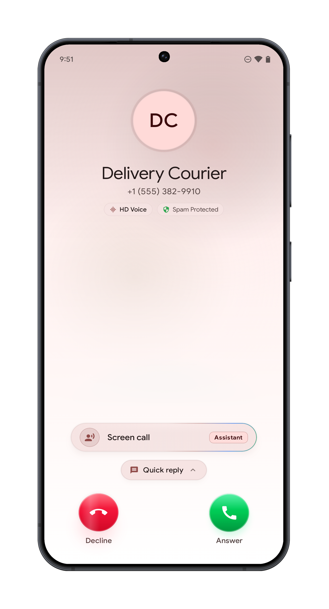
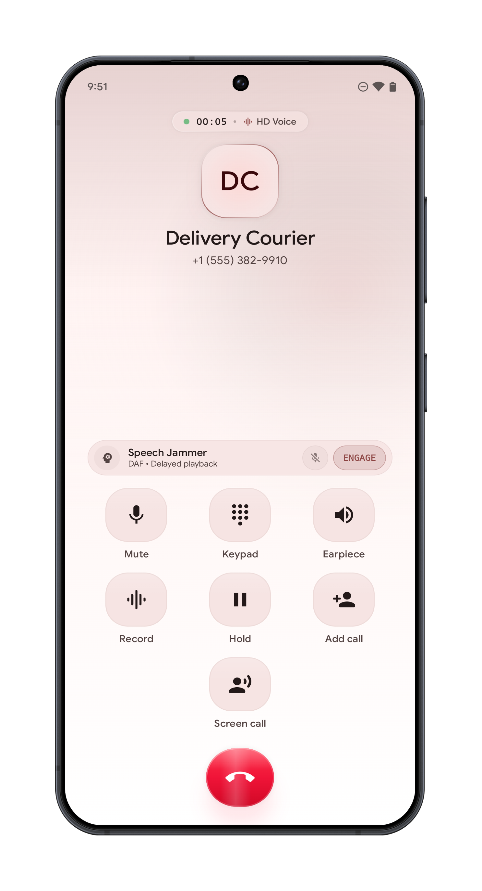
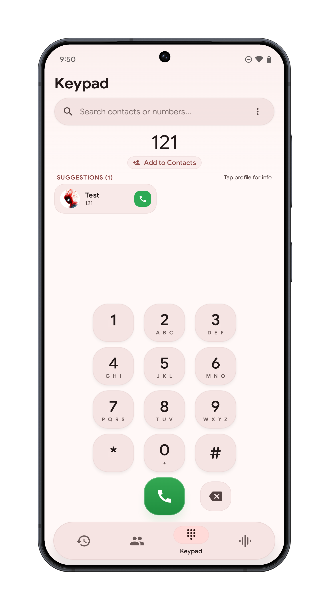
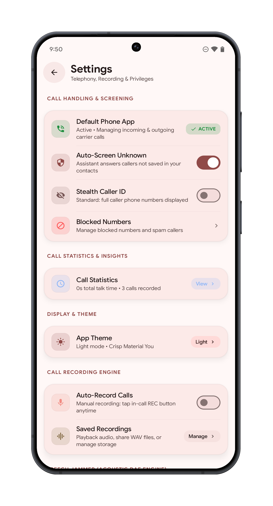
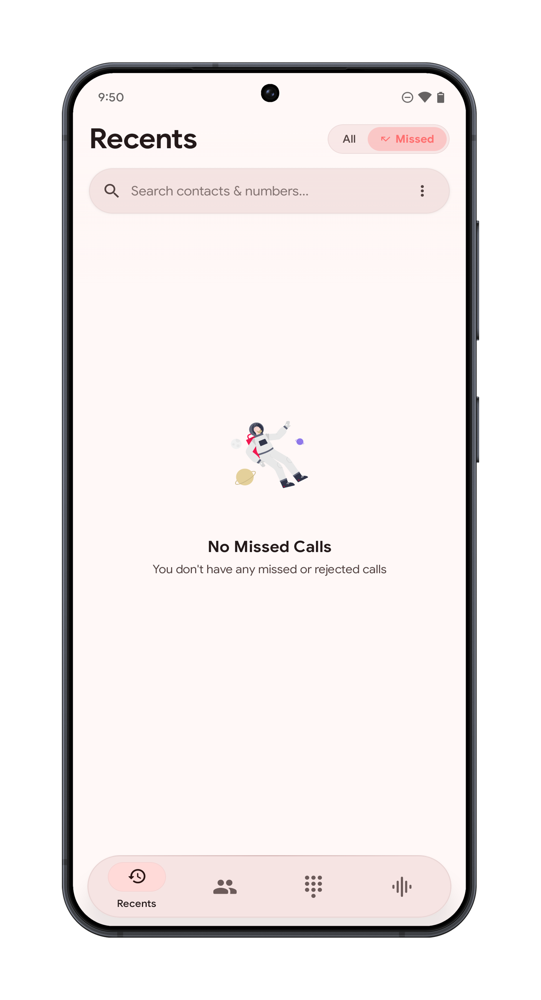

# Resonix v1.0.0 — Official Release

Next-generation Android dialer and smart call screening system built with Kotlin and Jetpack Compose, featuring Material You expressive design, dual-mode root and non-root architecture, and intelligent telephony management.

---

## Visual Showcase

Resonix provides a clean, native Android experience adapted for both light and dark system themes with wallpaper-derived Monet dynamic coloring.

### Call Experience and AI Screening

| 1. Incoming Call | 2. In-Call Telephony Suite | 3. Live AI Screening Studio |
| :---: | :---: | :---: |
|  |  |  |
| **Incoming Call Screen** Ambient liquid backdrop, caller ID verification, spam protection badge, and one-tap AI screening invocation. | **In-Call Controls Suite** Active call timer, direct audio path indicators, hold, mute, speaker, keypad, record, add call, and speech jammer. | **Live AI Screening Studio** Real-time speech-to-text live transcripts, instant contextual quick replies, natural voice relay, and direct take-over. |

### Dialer, Contacts, Settings and History

| 4. Contact Details & Rules | 5. Smart T9 Keypad & Dialer | 6. Telephony Settings & Theme | 7. Recents & History |
| :---: | :---: | :---: | :---: |
|  |  |  |  |
| **Contact Info & Rules** Profile management, direct actions, per-caller automated screening rules, VIP exemptions, and custom voice personas. | **Smart T9 Keypad & Dialer** Rapid T9 contact search suggestions, tactile dialpad keys with haptic feedback, and fluid bottom navigation. | **Settings & Theme Engine** Default Phone app handler, spam filters, statistics, call recording engine, and dynamic light/dark theme switch. | **Recents & Call History** Filterable call logs by all and missed calls, integrated search bar, and contact linking. |

---

## Highlights and Features

### 1. Standard Mode (Non-Root / Any Android 8.0+ Device)
Requires zero root permissions or system modifications and serves as your full primary Phone dialer:
* **Default Phone Dialer:** Complete Android Telecom subsystem integration handling all cellular calls.
* **Material You Dynamic Theming:** Native Monet color extraction supporting both light and dark modes with high-contrast legibility.
* **Smart T9 Keypad:** Fast contact searching as you type digits, with haptic feedback and dial suggestions.
* **In-Call Telephony Management:**
  * One-tap hold, mute, speakerphone routing, and standard DTMF keypad.
  * Add call capability with conference merge and active call swapping.
  * Robust multi-call state management ensuring background calls remain controllable.
* **Dynamic Call Capsule:** System-wide floating pill overlay for multitasking during ongoing calls.
* **Contact & Call Log Center:** Filterable call logs (All / Missed), speed dial favorites, and per-contact details.
* **Spam & Number Blocking:** Local database for blacklisting spam numbers and blocking unwanted callers.
* **In-App GitHub OTA Updates:** Direct release checking and update installation prompts.

### 2. Root-Enhanced Mode (Magisk / KernelSU / APatch)
Unlockable when granted superuser access via an automated system module mounting Resonix into `/system/priv-app/Resonix/`:
* **Direct Hardware Audio Injection:**
  * Uses privileged `CAPTURE_AUDIO_OUTPUT` and `MODIFY_AUDIO_ROUTING` permissions.
  * Injects 16-bit 16kHz linear PCM digital audio streams directly into the cellular modem uplink mixer.
* **Zero Room Noise (Loudspeaker Off):**
  * Caller audio and synthesized screening responses do not play through the phone speaker.
  * Keeps your conversations private without alerting people nearby.
* **Live AI Call Screening:**
  * Real-time speech-to-text transcript feed with conversational message bubbles.
  * Contextual quick replies for one-tap automated responses.
  * Interactive text relay to type any custom response and speak it directly to the caller.
* **Multi-Persona Voice Engine:**
  * Multiple built-in neural voice personas suited for casual, formal, or business screening.
* **Speech Jammer Tool:**
  * Direct-to-line delayed auditory feedback (DAF) engine to deter telemarketers and robocallers.
* **Silent Background OTA Updates:**
  * One-tap background module and package updates without standard installer prompts.

---

## Download and Installation

* **Release APK:** `Resonix-v1.0.0-release.apk`
* **Requirements:** Android 8.0 (API 26) or higher. Target SDK: Android 14 (API 34).
* **Setup:**
  1. Download and install `Resonix-v1.0.0-release.apk`.
  2. Open Resonix and grant the requested Phone and Call Screening permissions.
  3. Set Resonix as your default Phone app.
  4. (Optional for rooted devices) Tap **Activate Magisk / KernelSU Priv-App Module** on the dashboard and reboot to enable direct hardware audio injection and AI screening.
